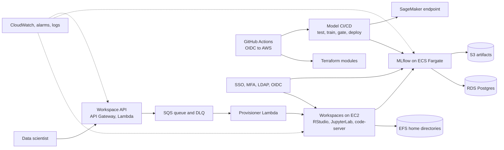

# ds-platform

**Data Science Platform Lab.** A hands-on, end-to-end build of a self-service, governed data science platform on AWS. It is a personal lab that mirrors the day-to-day scope of a Senior Data Science Platform Developer role: provisioning workspaces, running MLflow, shipping models through CI/CD, securing access, standardising IDEs, observing and costing everything, and proving it can recover.

Everything is built with Terraform, at minimal cost, with public sample data only.

## Why this exists

Learn by building the real thing rather than reading about it. Each feature is a realistic stakeholder request, delivered as code, verified, documented and explained back. The result is a working platform and a portfolio repo.

## Goals

- Provision data science workspaces (RStudio, JupyterLab, VS Code) on demand and keep user files safe.
- Run shared MLflow tracking and a model registry, and deploy models through quality-gated CI/CD.
- Control access with SSO, MFA, LDAP-backed groups and OAuth 2.0 / OIDC.
- Provide package mirrors, app publishing and standard IDEs, with open-source stand-ins by default.
- Compare deployment paths: ECS, SageMaker and Kubernetes.
- Make the platform observable, tagged, cost-aware, patched, backed up and restorable.
- Rebuild it all from a fresh clone and demonstrate it in 20 minutes.

## Out of scope

- Any employer data, systems or credentials.
- Production-scale capacity and multi-account landing zones.
- Paid Posit and Datadog licences beyond optional trials.

## Target architecture



## Roadmap

Two-week sprints, starting 9 Nov 2026. Each feature ends with a fault drill, a runbook and an explain-back.

| Sprint | Dates | Feature | Outcome (gate) |
| --- | --- | --- | --- |
| S0 | Nov 1 - 8 | **F01** Foundation | Fresh clone runs `terraform init` and `plan` against remote state |
| S0 | | **F02** Network and first workspace | Workspace with persistent files survives a rebuild |
| S0 | | **F03** Everything as code and review | PR with a missing tag fails; corrected PR passes |
| S1 | Nov 9 - 20 | **F04** Self-service workspace API | Request, status change, email, and a poisoned message lands in the DLQ |
| S2 | Nov 23 - Dec 4 | **F05** Shared MLflow service | Run logged from workspace appears in UI; artifact in S3 |
| S3 | Dec 7 - 18 | **F06** Model CI/CD with quality gates | Failing test blocks deploy; rollback works |
| S4 | Dec 21 - Jan 1 | **F07** Identity and access | Group controls access; outsider is refused |
| S4 | | **F08** Posit and IDE stack | `install.packages` and `pip install` use the mirror; app publishes |
| S5 | Jan 4 - 15 | **F09** SageMaker path and comparison | Endpoint predicts; lineage in MLflow; no endpoint left running |
| S5 | | **F10** Kubernetes comparison | Healthy pods; rolling update with no downtime |
| S6 | Jan 18 - 29 | **F11** Observability | Test fault fires an alarm; runbook fixes it |
| S6 | | **F12** Service catalogue, cost, governance | Catalogue product launches tagged; idle workspaces stop |
| S7 | Feb 1 - 12 | **F13** Resilience and Responsible AI | Restore drill passes; deploy blocked without a model card |
| S7 | | **F14** End-to-end demo | Full demo from a fresh clone |

## Skills covered

AWS (IAM, VPC, EC2, EFS, S3, Lambda, SQS, SNS, DynamoDB, ECS, ECR, RDS, SageMaker, Secrets Manager, CloudWatch, Service Catalog), Terraform, GitHub Actions and OIDC, Docker, Kubernetes and Helm, MLflow, Posit and open-source equivalents, SSO, MFA, LDAP, OAuth 2.0, Linux and Bash, Python automation, observability, patching, backup and recovery, tagging and cost governance, Responsible AI, documentation.

## How the work is tracked

Planned and tracked in GitHub Issues and a Project board, Jira-style:

| Jira | Here |
| --- | --- |
| Feature (epic) | Issue labelled `type:feature`, F01 to F14 |
| Story | Sub-issue of a feature, ID like `F01-S04` |
| Bug | Issue labelled `type:bug`: a planted fault found while building |
| Sprint | Milestone S0 to S7 |
| Board | Project "DS Platform Lab Board" |

Stories run in order. Each states what it needs, what it produces and what comes next. Planted bugs give symptoms only; the causes are sealed until you have diagnosed them yourself.

## Lab environment

| Item | Value |
| --- | --- |
| AWS account | `841323371662` (standalone, no Organization) |
| Region | `ap-south-1` (Mumbai) |
| CLI profile | `admin` (IAM user with MFA, short-lived credentials via `aws login`) |
| Infrastructure as code | Terraform |
| Budget | $10 monthly, alerts at 50%, 80% and 100% |

No long-lived access keys. Root is not used for daily work.

## Getting started

Tools: AWS CLI v2 (2.32+), Terraform, Git, GitHub CLI, Python 3.

```bash
aws login --profile admin
export AWS_PROFILE=admin            # PowerShell: $env:AWS_PROFILE="admin"
aws sts get-caller-identity         # must show user/admin, not root
```

## Guardrails

- Terraform for everything, including Service Catalog. No console-only resources.
- Every AWS resource carries `project`, `owner`, `env` and `cost-centre` tags.
- Destroy lab resources at the end of each session. Cost stays minimal.
- Never commit employer data or credentials. See [CONTRIBUTING.md](CONTRIBUTING.md#data-and-credentials-rule). Public sample data only.
- `main` is protected; changes go through a reviewed pull request.
- Kubernetes and Datadog are in scope but are the first things to defer if time runs short.

## Working agreement

Branch per story (`F01-S05-terraform-state`), a pull request with `Closes #<issue>`, and a definition of done that includes infrastructure in Terraform, logs or alarms for anything running, and updated docs. Details are in [CONTRIBUTING.md](CONTRIBUTING.md).

## Repository layout

| Path | Purpose |
| --- | --- |
| `infra/` | Terraform, one folder per feature or module |
| `src/` | Application and pipeline code (Python) |
| `docs/` | Runbooks, user guides and phase write-ups |

Folders are added as stories need them.

## Progress

- [x] F01-S01 AWS account created, root locked down
- [x] F01-S02 Admin identity and CLI configured
- [x] F01-S03 Budget and cost safety net
- [x] F01-S04 Repository with README, `.gitignore`, CONTRIBUTING and branch protection
- [ ] F01-S05 Terraform remote state with locking
- [ ] F01-S06 Tag standard and README skeleton
- [ ] F02 to F14
